# Bastón Inteligente

Sitio web del proyecto Bastón Inteligente: un dispositivo con sensores ultrasónicos que ayuda a personas con discapacidad visual a desplazarse con más seguridad y autonomía. El sitio presenta el proyecto, el curso, el blog, las preguntas frecuentes, el equipo y un formulario de contacto.

Migración de la maqueta HTML a PHP con modularización (SSI) y renderizado del lado del servidor (SSR).

## Diseño (Figma)

https://www.figma.com/design/V1gT11L9nYi4moaFg3vXZf/Sin-t%C3%ADtulo?node-id=0-1&t=1X1RfMfWXLL3gRbK-1

## Tecnologías

- HTML5
- CSS3 (estilos propios, diseño responsive y modo oscuro)
- JavaScript (menú móvil, modo oscuro, reloj, galería con lightbox, validación de formularios)
- PHP 8 (includes, variables de entorno)
- Git y GitHub (ramas y Pull Requests)

## Estructura

```
Artaza/
├── includes/
│   ├── config.php     # carga el .env y define constantes
│   ├── header.php     # <head>, cabecera y título dinámico
│   ├── nav.php        # menú con la página activa
│   └── footer.php     # pie de página y scripts
├── css/estilos.css
├── js/main.js
├── img/
├── index.php  curso.php  blog.php  faq.php
├── quienes-somos.php  contactos.php  cv.php  guia-estudio.php
├── .env.example       # plantilla de variables de entorno
└── .gitignore         # excluye .env
```

## Cómo funciona la modularización

Cada página define sus variables y luego incluye las plantillas:

```php
<?php
$titulo_pagina = 'Blog';
$descripcion_pagina = '...';
require_once __DIR__ . '/includes/header.php';
?>

<!-- contenido propio de la página -->

<?php require_once __DIR__ . '/includes/footer.php'; ?>
```

- `$titulo_pagina` genera el `<title>` de cada página (`Título | Nombre de la app`).
- `nav.php` compara la página actual con cada ítem del menú y agrega la clase `active` (y `aria-current="page"`) al que corresponde.

## Variables de entorno

| Variable | Descripción |
|---|---|
| `APP_NAME` | Nombre de la aplicación (título y pie de página) |
| `CONTACT_EMAIL` | Correo de contacto (pie de página) |
| `APP_ENV` | Entorno: `local` muestra errores de PHP; cualquier otro valor los oculta |

## Instalación y ejecución

1. Instalar [XAMPP](https://www.apachefriends.org/)
2. Clonar el repositorio dentro de `htdocs` (XAMPP)
3. Copiar `.env.example` como `.env` y completar los valores.
4. Iniciar Apache y abrir `http://localhost/Artaza/` en el navegador.

## Capturas

Las capturas están en `docs/capturas/`:

1. Sitio funcionando en `localhost`.
2. Código de las plantillas (`includes/` y una página que las usa).
3. Título dinámico y menú con la página activa.
4. Archivo `.env.example`.

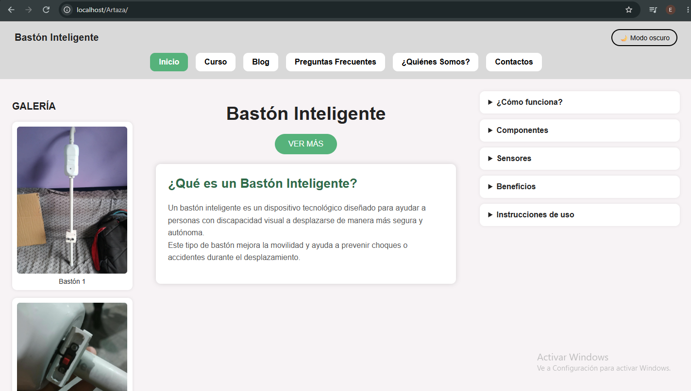
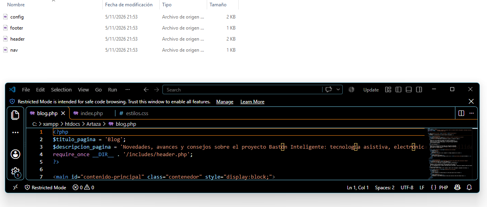
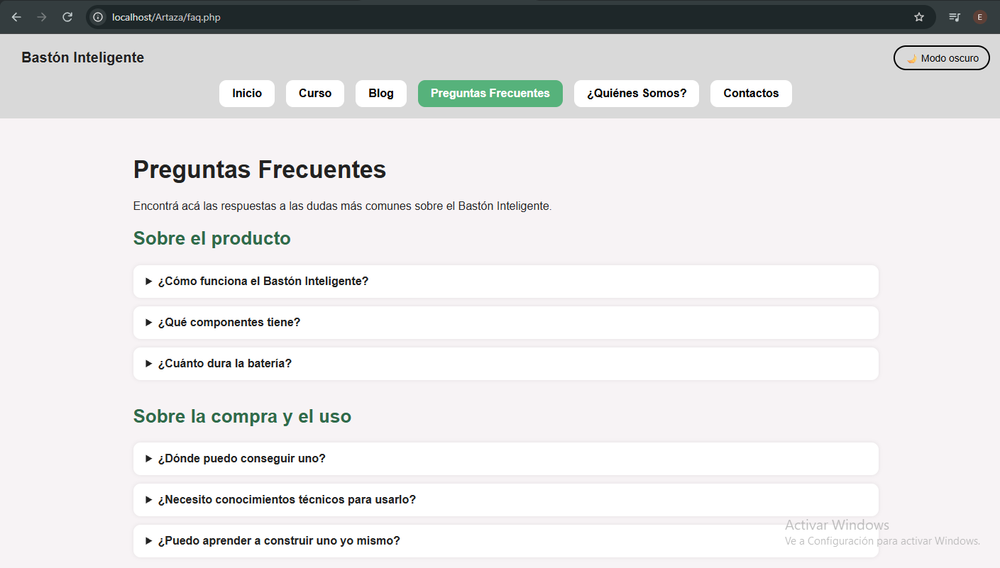
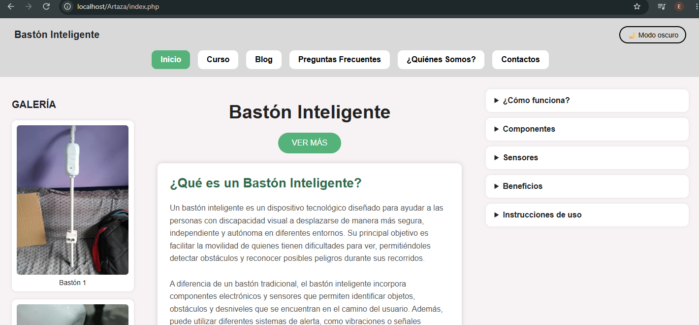
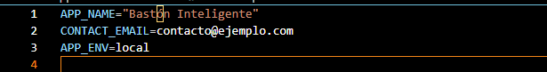

## Autor

Cruz Mendez Facundo Mauricio

---

# Clase 5 – Formularios con POST y GET (`clase5/`)

Todo el desarrollo de esta entrega está en la carpeta [`clase5/`](clase5/), que contiene el sitio completo (con las plantillas SSI de la Clase 4) más el procesamiento de formularios del lado del servidor.

## Formularios creados

### 1. Formulario de contacto – método POST (`clase5/contactos.php`)

Recibe nombre, correo, teléfono (opcional), motivo, mensaje y aceptación de contacto.

- **Sanitización:** cada dato pasa por `limpiar()` (`includes/formularios.php`), que aplica `trim()` y elimina caracteres de control. Todo lo que se imprime en pantalla pasa por `e()` (`htmlspecialchars()` con `ENT_QUOTES` y UTF-8), por lo que un `<script>` ingresado se muestra como texto y no se ejecuta.
- **Validación en servidor:** campos obligatorios (`''`/`isset()`), largo mínimo y máximo, formato de correo con `filter_var(..., FILTER_VALIDATE_EMAIL)`, formato del teléfono con expresión regular, y el motivo se valida contra una lista blanca.
- **Mensajes:** si hay errores se muestra un recuadro con la lista de problemas y el mensaje debajo de cada campo; si todo está bien se muestra un mensaje de éxito con los datos recibidos.
- **Persistencia:** ante un error se conservan todos los campos ya completados (texto, select y checkbox).
- **Post/Redirect/Get:** tras un envío correcto se redirige a la misma página, así al recargar no se reenvía el formulario.

### 2. Buscador y filtro del blog – método GET (`clase5/blog.php`)

Formulario con un campo de búsqueda (`?q=`) y un filtro por categoría (`?categoria=`). Los parámetros se sanitizan y validan antes de usarse (máximo 50 caracteres; la categoría debe estar en la lista permitida), se filtran las entradas y se informa cuántos resultados hay. Los valores se conservan en el formulario y siempre se imprimen con `e()`.

Ejemplos: `blog.php?q=sensor` · `blog.php?categoria=Electrónica` · `blog.php?q=arduino&categoria=Electrónica`

## Archivos nuevos o modificados en la Clase 5

| Archivo | Cambio |
|---|---|
| `clase5/includes/formularios.php` | Nuevo: funciones `limpiar()`, `post_limpio()`, `get_limpio()` y `largo()` |
| `clase5/contactos.php` | Formulario POST con validación, mensajes y persistencia |
| `clase5/blog.php` | Entradas en un array + buscador y filtro GET |
| `clase5/js/main.js` | El JS ya no intercepta el envío: solo ayuda a validar al salir de cada campo |
| `clase5/css/estilos.css` | Estilos de las alertas de éxito/error y del buscador |

## Ejecución

Igual que la Clase 4: copiar `clase5/.env.example` como `clase5/.env`, iniciar Apache en XAMPP y abrir `http://localhost/Artaza/clase5/` (ajustar según la carpeta donde esté clonado el repositorio).

## Capturas de la Clase 5

Las capturas están en `clase5/docs/capturas/`.

**Formulario POST – errores de validación y datos conservados**

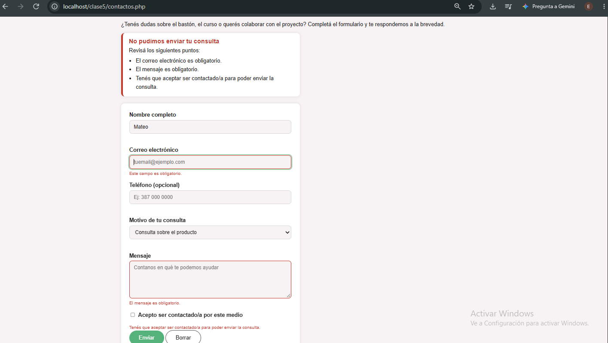

**Formulario POST – envío exitoso**

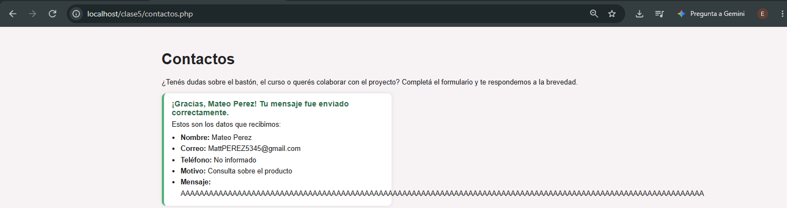

**Formulario POST – intento de XSS mostrado como texto**

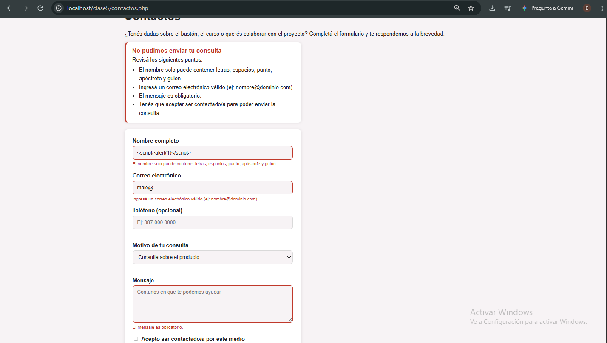

**Formulario GET – búsqueda con resultados**

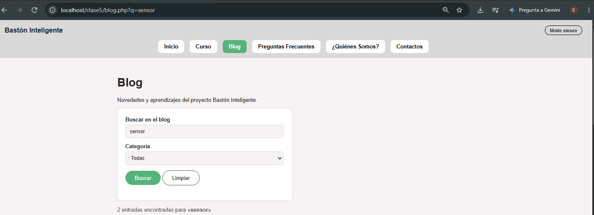

**Formulario GET – búsqueda sin resultados**

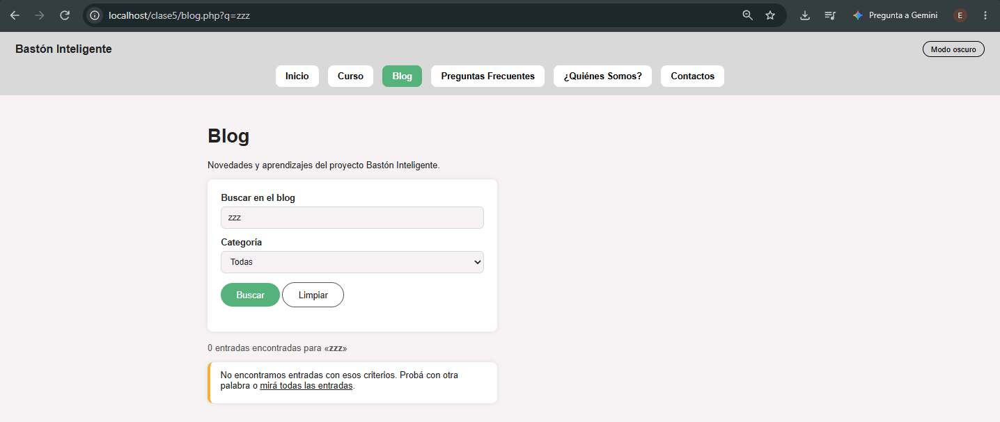


---

# TP N 7 – Persistencia y conexión segura PHP–MySQL (`tp7/`)

Todo el desarrollo está en la carpeta [`tp7/`](tp7/): el sitio completo (con las plantillas SSI y los formularios de las clases anteriores) más un panel de administración que hace el CRUD de la tabla `entradas` de la base `baston_inteligente` diseñada en el TP 6.

## Qué se implementó

| Archivo | Función |
|---|---|
| `tp7/config/conexion.php` | Conexión PDO con `try-catch (PDOException)`. Los datos de acceso se leen del `.env` |
| `tp7/admin/index.php` | **Read**: listado de entradas con `INNER JOIN` a categorías y usuarios |
| `tp7/admin/crear.php` | **Create**: formulario + `INSERT` preparado |
| `tp7/admin/editar.php` | **Update**: formulario precargado + `UPDATE` preparado con `WHERE id` |
| `tp7/admin/eliminar.php` | **Delete**: `DELETE` preparado, solo por POST y con token CSRF |
| `tp7/includes/entradas_crud.php` | Validación y funciones compartidas del CRUD |

## Seguridad

- **Consultas preparadas** con `:parametros` en todos los `INSERT`, `UPDATE`, `DELETE` y en los `SELECT` que reciben datos del usuario, con `PDO::ATTR_EMULATE_PREPARES => false` (previene inyección SQL).
- **XSS:** todo lo que se imprime en las vistas pasa por `e()` (`htmlspecialchars()`).
- **Validación en servidor:** campos obligatorios, largos, categoría y autor contra los registros existentes, fecha válida y ruta de imagen restringida.
- **Eliminar** no funciona con un enlace GET: requiere POST con token CSRF y confirmación en pantalla.
- **Credenciales fuera del código:** usuario y contraseña de la base van en `tp7/.env` (excluido por `.gitignore`); en el repositorio solo está `tp7/.env.example`.

## Instalación y ejecución local

1. Tener creada la base: importar `tp6/schema.sql` y luego `tp6/consultas.sql` en phpMyAdmin.
2. Copiar `tp7/.env.example` como `tp7/.env` y completar `DB_USER` y `DB_PASS` (y `DB_PORT` si MySQL no usa el 3306).
3. Copiar la carpeta `tp7` dentro de `htdocs` e iniciar Apache.
4. Abrir `http://localhost/tp7/admin/`.

## Capturas

**Listado de entradas (Read)**

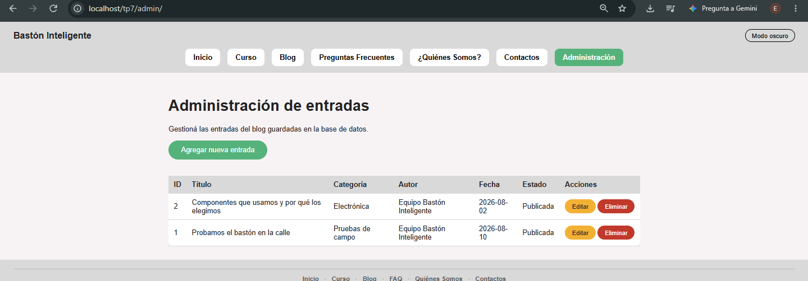

**Crear una entrada (validación y alta)**

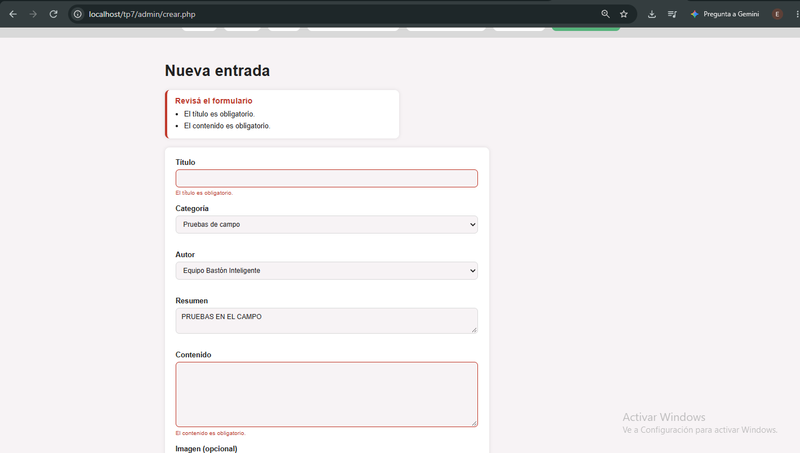

**Editar una entrada (Update)**

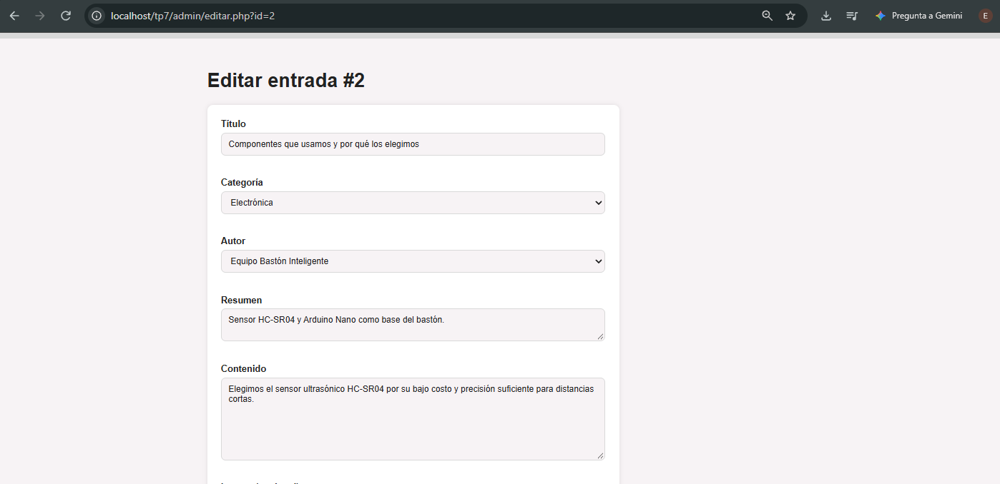

**Eliminar con confirmación (Delete)**

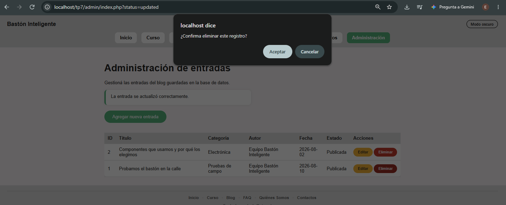

**Cambios reflejados en la base de datos (phpMyAdmin)**

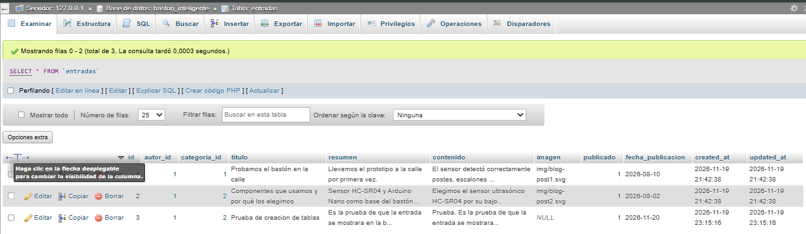


