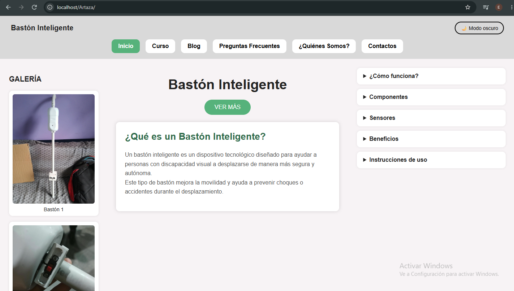
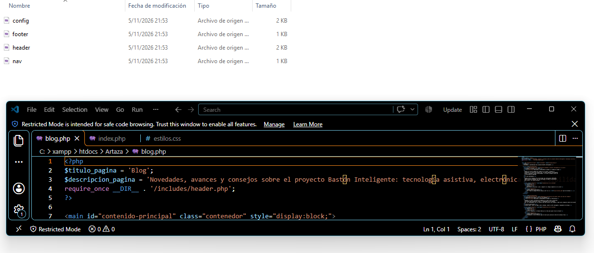
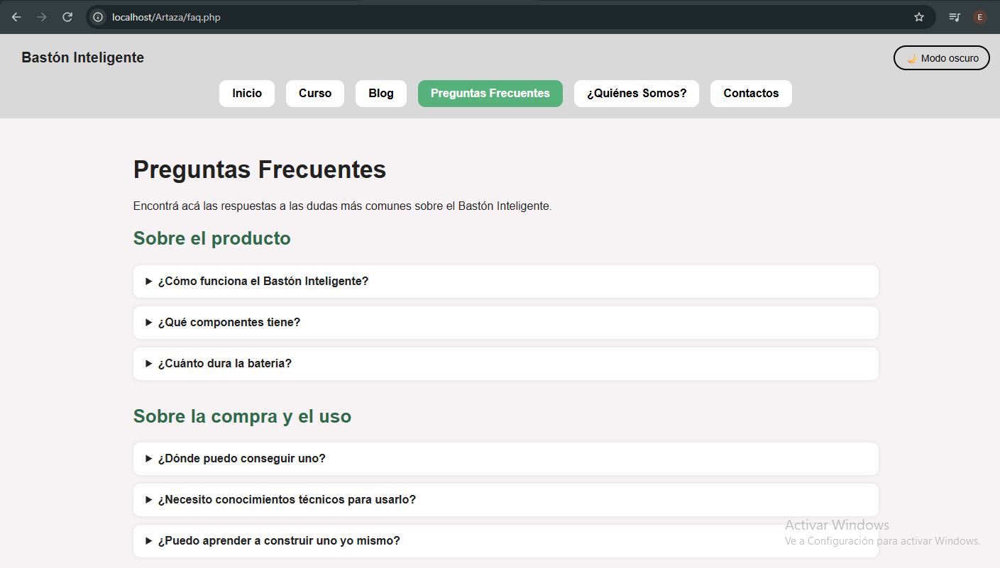
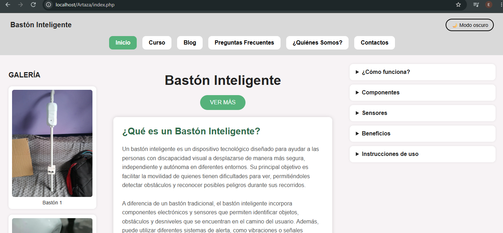
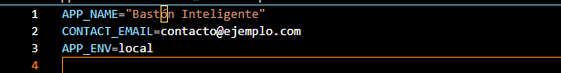

# Bastón Inteligente

Sitio web del proyecto Bastón Inteligente: un dispositivo con sensores ultrasónicos que ayuda a personas con discapacidad visual a desplazarse con más seguridad y autonomía. El sitio presenta el proyecto, el curso, el blog, las preguntas frecuentes, el equipo y un formulario de contacto.

Migración de la maqueta HTML a PHP con modularización (SSI) y renderizado del lado del servidor (SSR).

## Diseño (Figma)

https://www.figma.com/design/V1gT11L9nYi4moaFg3vXZf/Sin-t%C3%ADtulo?node-id=0-1&t=1X1RfMfWXLL3gRbK-1

## Tecnologías

- HTML5
- CSS3 (estilos propios, diseño responsive y modo oscuro)
- JavaScript (menú móvil, modo oscuro, reloj, galería con lightbox, validación de formularios)
- PHP 8 (includes, variables de entorno)
- Git y GitHub (ramas y Pull Requests)

## Estructura

```
Artaza/
├── includes/
│   ├── config.php     # carga el .env y define constantes
│   ├── header.php     # <head>, cabecera y título dinámico
│   ├── nav.php        # menú con la página activa
│   └── footer.php     # pie de página y scripts
├── css/estilos.css
├── js/main.js
├── img/
├── index.php  curso.php  blog.php  faq.php
├── quienes-somos.php  contactos.php  cv.php  guia-estudio.php
├── .env.example       # plantilla de variables de entorno
└── .gitignore         # excluye .env
```

## Cómo funciona la modularización

Cada página define sus variables y luego incluye las plantillas:

```php
<?php
$titulo_pagina = 'Blog';
$descripcion_pagina = '...';
require_once __DIR__ . '/includes/header.php';
?>

<!-- contenido propio de la página -->

<?php require_once __DIR__ . '/includes/footer.php'; ?>
```

- `$titulo_pagina` genera el `<title>` de cada página (`Título | Nombre de la app`).
- `nav.php` compara la página actual con cada ítem del menú y agrega la clase `active` (y `aria-current="page"`) al que corresponde.

## Variables de entorno

| Variable | Descripción |
|---|---|
| `APP_NAME` | Nombre de la aplicación (título y pie de página) |
| `CONTACT_EMAIL` | Correo de contacto (pie de página) |
| `APP_ENV` | Entorno: `local` muestra errores de PHP; cualquier otro valor los oculta |

## Instalación y ejecución

1. Instalar [XAMPP](https://www.apachefriends.org/)
2. Clonar el repositorio dentro de `htdocs` (XAMPP)
3. Copiar `.env.example` como `.env` y completar los valores.
4. Iniciar Apache y abrir `http://localhost/Artaza/` en el navegador.

## Capturas

Las capturas están en `docs/capturas/`:

1. Sitio funcionando en `localhost`.
2. Código de las plantillas (`includes/` y una página que las usa).
3. Título dinámico y menú con la página activa.
4. Archivo `.env.example`.







## Autor

Cruz Mendez Facundo Mauricio
