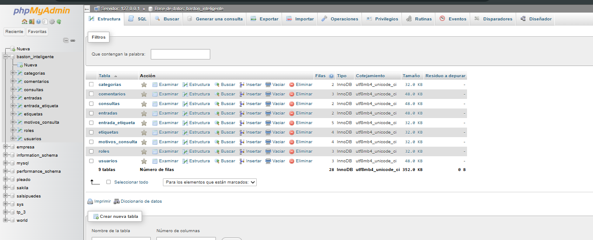
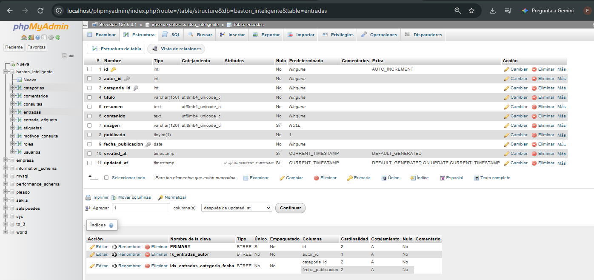
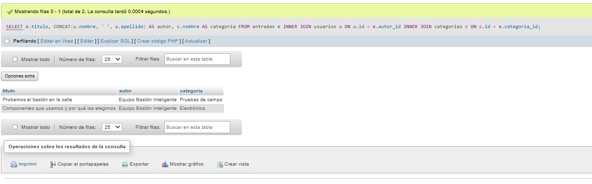

# TP 6 – Normalización del esquema (Bastón Inteligente)

Cruz Mendez Facundo Mauricio

El sitio del Bastón Inteligente tiene un blog con entradas que pertenecen a una categoría, tienen etiquetas y reciben comentarios de usuarios, y un formulario de contacto cuyas consultas conviene guardar. Para la normalización tomo la entidad **entrada del blog**, que es la que mezcla más información.

## Parte 1

### 1. Tabla principal sin normalizar

Un registro hipotético donde todo está junto en una sola tabla `entradas_blog`:

| id_entrada | titulo | categoria | autor | email_autor | rol_autor | etiquetas | comentarios |
|---|---|---|---|---|---|---|---|
| 1 | Probamos el bastón en la calle | Pruebas de campo | Equipo Bastón Inteligente | equipo@baston.com | editor | sensor, prototipo, accesibilidad | Marina: "¡Excelente iniciativa!"; Equipo: "¡Sí! Está en la guía" |
| 2 | Componentes que usamos | Electrónica | Equipo Bastón Inteligente | equipo@baston.com | editor | sensor, arduino | Julián: "¿Sirve un Arduino Uno?" |

Problemas que se observan:
- **Campos multivalorados:** `etiquetas` y `comentarios` guardan varias cosas en una sola celda.
- **Redundancia:** los datos del autor (`autor`, `email_autor`, `rol_autor`) se repiten en cada entrada. Si cambia el correo del equipo, hay que corregirlo en todas las filas.
- **Anomalías:** no se puede registrar una categoría nueva sin una entrada; si se borra la única entrada de una categoría, se pierde la categoría.

### 2. Proceso de normalización

#### 1FN – cada campo atómico

Se eliminan las listas. Las etiquetas y los comentarios pasan a ser una fila por cada valor:

| id_entrada | titulo | categoria | autor | email_autor | rol_autor | etiqueta | comentario_autor | comentario_texto |
|---|---|---|---|---|---|---|---|---|
| 1 | Probamos el bastón… | Pruebas de campo | Equipo… | equipo@baston.com | editor | sensor | Marina | ¡Excelente iniciativa! |
| 1 | Probamos el bastón… | Pruebas de campo | Equipo… | equipo@baston.com | editor | sensor | Equipo | ¡Sí! Está en la guía |
| 1 | Probamos el bastón… | Pruebas de campo | Equipo… | equipo@baston.com | editor | prototipo | Marina | ¡Excelente iniciativa! |
| … | … | … | … | … | … | … | … | … |

Ahora todo es atómico, pero se repite aún más información. La clave pasa a ser compuesta: (`id_entrada`, `etiqueta`, `comentario`).

#### 2FN – sin dependencias parciales

Con la clave compuesta, hay columnas que dependen solo de una parte de ella:
- `titulo`, `categoria`, `autor`, `email_autor`, `rol_autor` dependen solo de `id_entrada`.
- `etiqueta` es independiente de los comentarios, y los comentarios de las etiquetas.

Se descompone en tablas, cada una con sus propios datos:

- `entradas (id_entrada PK, titulo, categoria, autor, email_autor, rol_autor)`
- `entrada_etiqueta (id_entrada, etiqueta)` con clave compuesta
- `comentarios (id_comentario PK, id_entrada, comentario_autor, comentario_texto)`

#### 3FN – sin dependencias transitivas

En `entradas` quedan dependencias entre columnas que no son clave:
- `id_entrada → autor → email_autor, rol_autor`: el correo y el rol dependen del autor, no de la entrada.
- `categoria` es un dato con identidad propia (un catálogo).
- `etiqueta` es también un catálogo: el texto "sensor" se repite en muchas filas de `entrada_etiqueta`.
- Los datos de quien comenta son los mismos datos de un usuario.
- `rol_autor` es un catálogo.

Se extraen a sus propias tablas y se reemplazan por claves foráneas:
- `usuarios` (autor y comentaristas, con `rol_id`), `roles`, `categorias`, `etiquetas`.
- `entradas` queda con `autor_id` y `categoria_id`.
- `entrada_etiqueta` queda con `entrada_id` y `etiqueta_id` (relación N:M).
- `comentarios` queda con `entrada_id` y `usuario_id`.

Además se modela el formulario de contacto (Clase 5): `consultas`, con su catálogo `motivos_consulta` (producto, curso, colaboración, otro), que es el mismo desplegable del formulario.

### 3. Listado de tablas resultante

| Tabla | PK | FK |
|---|---|---|
| `roles` | `id` | – |
| `categorias` | `id` | – |
| `etiquetas` | `id` | – |
| `motivos_consulta` | `id` | – |
| `usuarios` | `id` | `rol_id` → `roles.id` |
| `entradas` | `id` | `autor_id` → `usuarios.id`, `categoria_id` → `categorias.id` |
| `entrada_etiqueta` | (`entrada_id`, `etiqueta_id`) | `entrada_id` → `entradas.id`, `etiqueta_id` → `etiquetas.id` |
| `comentarios` | `id` | `entrada_id` → `entradas.id`, `usuario_id` → `usuarios.id` |
| `consultas` | `id` | `motivo_id` → `motivos_consulta.id`, `usuario_id` → `usuarios.id` (opcional) |

### Diagrama de relaciones

```
roles 1───N usuarios 1───N entradas N───1 categorias
                 │              │
                 │              N
                 │       entrada_etiqueta
                 │              N
                 │              │
                 │          etiquetas
                 │
                 ├──N comentarios N───1 entradas
                 │
                 └──N consultas N───1 motivos_consulta
                    (usuario opcional)
```

Cada dato vive en un solo lugar: el correo de un autor está en `usuarios`, el nombre de una categoría en `categorias`, y así se evitan las anomalías de la tabla original.

## Parte 2 y 3

- [`schema.sql`](schema.sql): creación de la base `baston_inteligente`, las 9 tablas, claves foráneas, campos de auditoría e índices.
- [`consultas.sql`](consultas.sql): consultas CRUD de prueba. Ejecutarlo después de `schema.sql`. Para volver a correrlo desde cero, ejecutar otra vez `schema.sql`, que recrea las tablas vacías.


## Capturas






